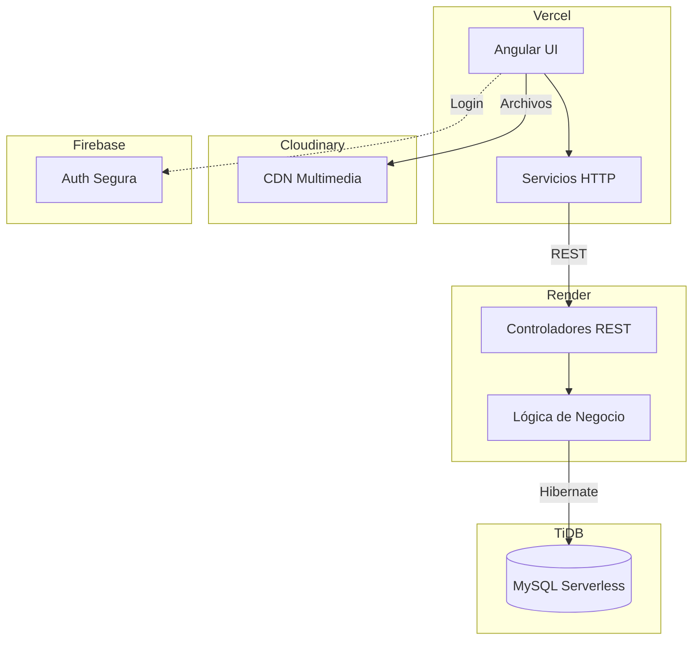
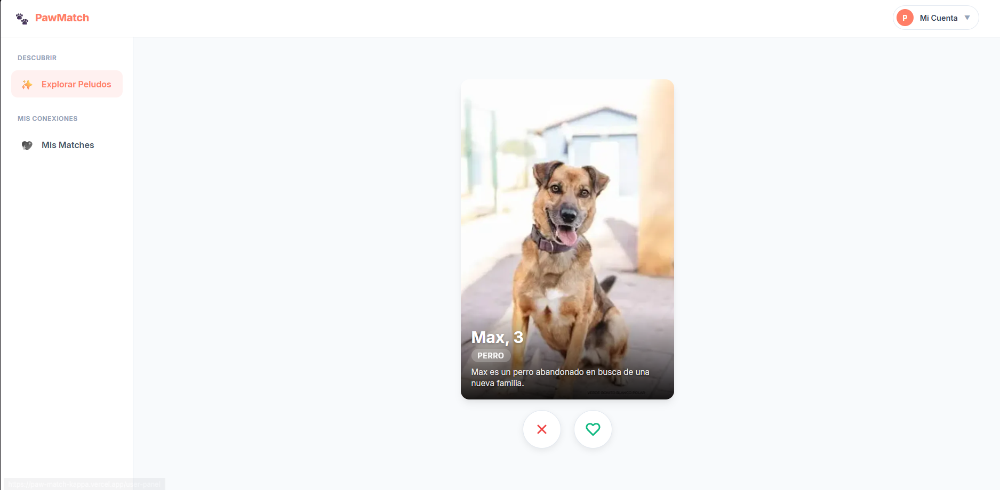
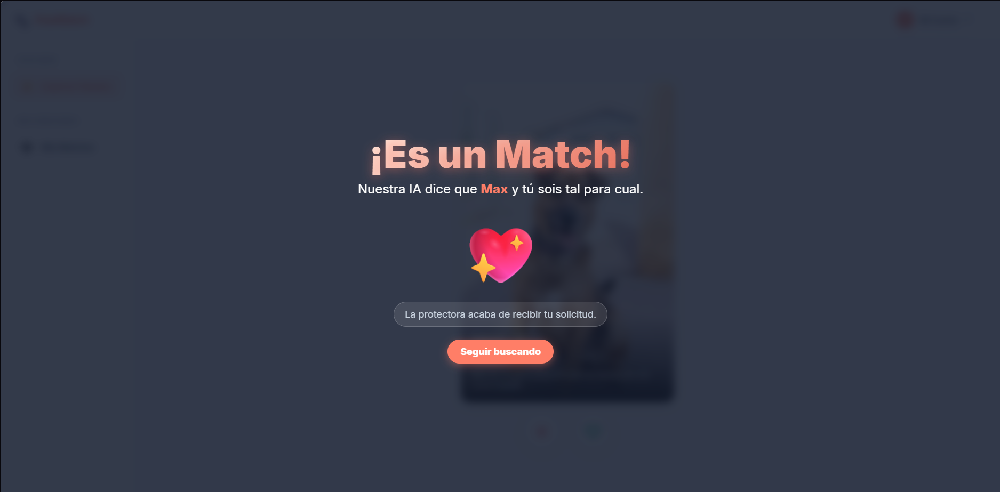
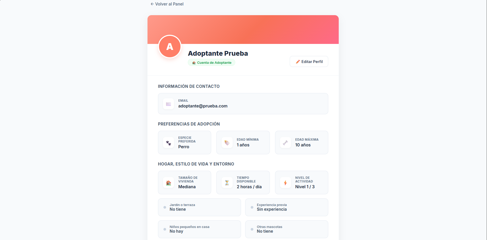
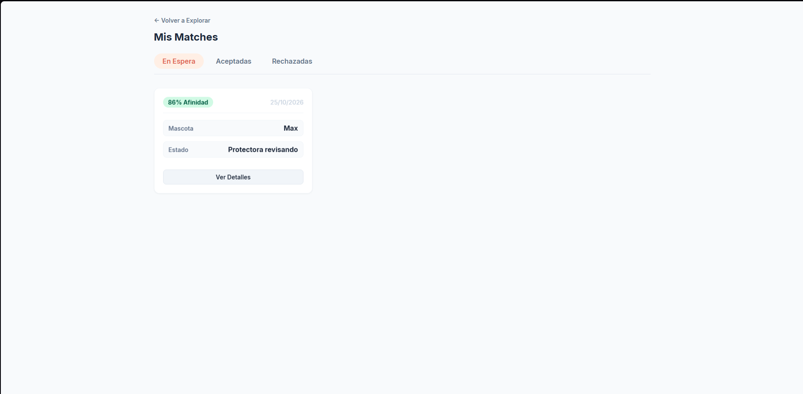
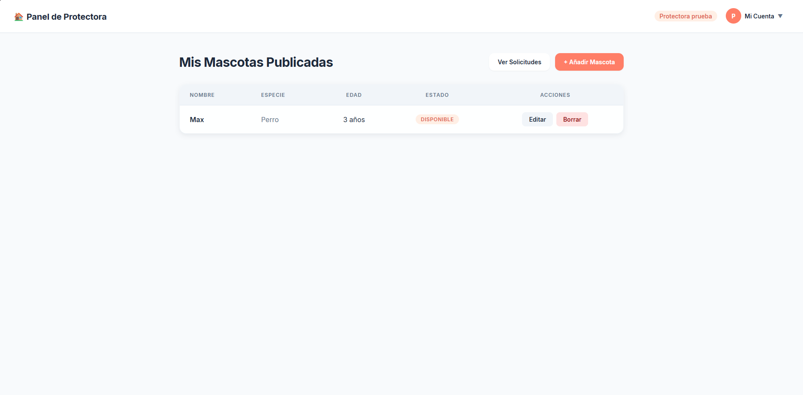
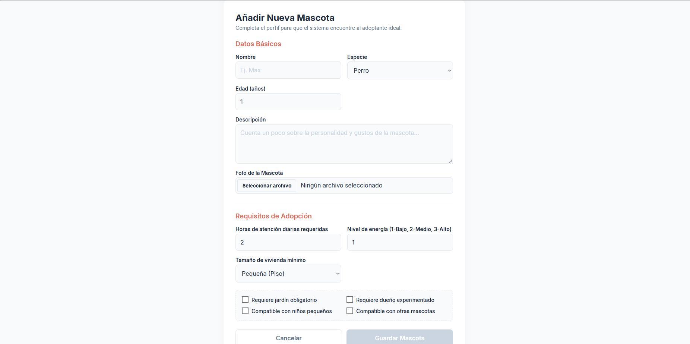
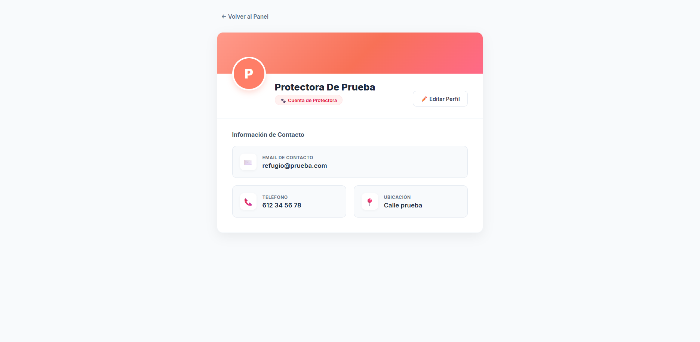
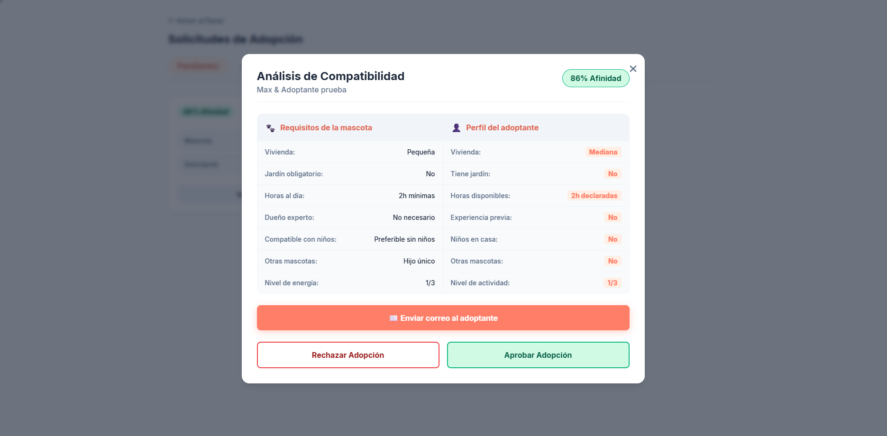

# PawMatch | Plataforma Inteligente de Adopción de Mascotas

**[🔗 Visitar web](paw-match-kappa.vercel.app)**

> Este repositorio contiene la base de código completa configurada para despliegue continuo en entornos de producción.

> [!WARNING]
> **Aviso sobre el tiempo de carga:** El servidor backend está alojado en la capa gratuita de Render. Si no ha recibido peticiones recientemente, entra en estado de hibernación. **El primer arranque puede tardar entre 30 y 50 segundos.** Una vez "despierto", la navegación será rápida y fluida.

---
## 💡 Acerca de la Aplicación
PawMatch es una plataforma integral diseñada para digitalizar y optimizar el proceso de adopción de mascotas. Conecta a refugios/protectoras con futuros adoptantes mediante un sistema de perfiles y un algoritmo de emparejamiento (Match). La aplicación está construida sobre una arquitectura distribuida: un cliente SPA en Angular alojado en Vercel, apoyado por una API REST en Spring Boot (Dockerizada) en Render, que persiste los datos en una base de datos MySQL. Además, integra servicios en la nube para la gestión segura de identidades (Firebase) y la optimización de recursos multimedia (Cloudinary).

## 🧪 Cuentas de Demostración
La aplicación está configurada con perfiles de prueba para evaluar las funcionalidades de ambos roles sin necesidad de registro.

| Rol | Email de Acceso | Contraseña | ¿Qué puedes probar? |
| :--- | :--- | :--- | :--- |
| **Adoptante** | `usuario@prueba.com` | `123456` | Ver catálogo, descubrir compatibilidad (Matches), gestionar perfil y solicitar adopciones. |
| **Protectora** | `refugio@prueba.com` | `123456` | Gestionar inventario de mascotas, editar perfiles y revisar el buzón de solicitudes entrantes. |

> [!TIP]
> Si prefieres probar el flujo de validación completo, también puedes registrarte con cualquier correo real.

## 🛠 Stack Tecnológico
*   **Frontend:** Angular 17+, TypeScript, SCSS, Vercel.
*   **Backend:** Java 21, Spring Boot, Gradle, Render (Docker).
*   **Base de Datos:** MySQL.
*   **Infraestructura & Seguridad:** Firebase Authentication, Cloudinary, Git Flow.

## 🏗 Arquitectura del Sistema


## 📸 Galería del Proyecto

La plataforma ofrece dos experiencias completamente adaptadas según el rol del usuario, garantizando que tanto los futuros adoptantes como las protectoras tengan las herramientas exactas que necesitan.

### Experiencia del Adoptante (Usuario)
Interfaz enfocada en el descubrimiento, algoritmo de compatibilidad y seguimiento de solicitudes.

<div align="center">
  
  &nbsp;&nbsp;&nbsp;&nbsp;
  
  <br><br><br>
  
  &nbsp;&nbsp;&nbsp;&nbsp;
  
</div>

<br>

### Panel de Gestión (Protectora / Refugio)
Herramientas administrativas para el control del inventario de animales, edición de perfiles y gestión de solicitudes de adopción.

<div align="center">
  
  &nbsp;&nbsp;&nbsp;&nbsp;
  
  <br><br><br>
  
  &nbsp;&nbsp;&nbsp;&nbsp;
  
</div>

## 📂 Estructura del Repositorio
El proyecto sigue una estructura de monorepositorio dividida por dominios tecnológicos. Consulta el **README interno de cada carpeta** para mas información sobre cada parte.
``` plaintext
paw-match/
├── backend/                # API REST (Spring Boot + Java 21)
│   ├── Dockerfile          # Configuración de contenedor Multi-stage (Gradle)
│   ├── src/main/java/...   # Controladores, Servicios, Repositorios, Entidades
│   └── README.md           # Información adicional sobre el backend
├── frontend/               # Cliente SPA (Angular)
│   ├── src/app/
│   │   ├── core/           # Servicios Singleton, Interceptores, Guards
│   │   ├── features/       # Módulos de dominio (home, user, shelter, pets)
│   │   └── shared/         # Componentes reutilizables, UI Kit
│   ├── vercel.json         # Configuración de enrutamiento y despliegue
│   └── README.md           # Información adicional sobre el frontend
└── README.md               # Documentación general del proyecto
```

## 🚀 Funcionalidades Principales
- **Gestión de Perfiles y Catálogo:** Creación y administración completa de perfiles para Refugios, Adoptantes y Mascotas.
- **Feed personalizado:** El sistema muestra mascotas que sean afines a tus preferencias para ayudarte a encontrar el compañero ideal.
- **Sistema de Match:** Cuando le des Like a una mascota el sistema comprueba si tu y esa mascotas sois compatibles (basándose en sus necesidades y tu perfil) antes de enviar una petición de adopción a la protectora.
- **Facilidad de comunicación para adoptar:** Cuando tengas un match la protectora y tu tendréis la opción de ver ese Match y comparar perfiles en cualquier momento, además tanto protectoras como usuarios podrán enviar un correo desde un botón para veros en persona, solicitar mas información o formalizar la adopcion.
- **Autenticación Segura:** Sistema de login gestionado a través de Firebase Auth, integrado con el ciclo de vida de Angular.

## 🧠 Retos Técnicos Superados
- **Despliegue de Java 21 en Entornos Cloud Gratuitos:** Ante la falta de soporte nativo para Java 21 en Render, diseñe un Dockerfile que descarga Gradle, compila la aplicación y la ejecuta en una imagen ligera de JRE, optimizando los tiempos de construcción.
- **Seguridad Frontend y Prevención de Abusos:** Protegui las API Keys públicas de Firebase y Cloudinary configurando listas blancas de dominios (CORS estricto) y políticas de subida sin firma que fuerzan límites de tamaño y resolución desde el propio servidor de Cloudinary.
- **Gestión Estricta de Entornos y Variables:** Implementé una separación clara entre desarrollo local y producción. Los secretos se inyectan mediante variables de entorno, esto me permite que no se filtren y estas claves solo están en mi servidor privado.

## 👤 Autor
- **Pablo Navia** - Desarrollador de Aplicaciones Multiplataforma.
- [Linkedin](https://www.linkedin.com/in/pablo-navia5)
